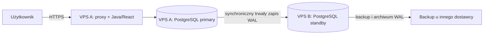

# Environments plan — dev local i production

Data: 2026-11-08. Status: **plan; dostawca i zakup jeszcze niezatwierdzone**. Zakres: budowa aplikacji i pierwsze 5–10 zaproszonych osób. Dev działa lokalnie, produkcja na płatnym hostingu; bez QA/staging. Użytkownik akceptuje samodzielne utrzymanie serwera.

## 1. Środowiska

| Element          | dev local                               | production                                     |
| ---------------- | --------------------------------------- | ---------------------------------------------- |
| Uruchomienie     | Java/Vite lokalnie, PostgreSQL w Docker | Docker Compose: aplikacja, proxy HTTPS i baza  |
| Firebase         | osobny projekt dev, Google Sign-In      | osobny projekt prod, Google Sign-In            |
| Dane             | lokalne/testowe, konta Mihu i ADMIN     | dane zaproszonych użytkowników                 |
| Wdrożenia        | lokalnie                                | po testach lokalnych i CI, uruchamiane ręcznie |

Obecny Compose zawiera tylko PostgreSQL. Logowanie Firebase, Dockerfile aplikacji i wdrożenia wymagają implementacji. Dwa serwery obsługujące produkcję nadal oznaczają **jedno środowisko prod**.

## 2. Sensowne tanie opcje

Ceny sprawdzone 2026-11-08. Kwoty „od” wymagają potwierdzenia lokalizacji, okresu zobowiązania, opłaty startowej i ceny odnowienia w koszyku. Domena i niezależne backupy są dodatkowo.

| Wariant                           | Miesięczny koszt bazowy                             | Ochrona przy utracie jednego serwera                          |
| --------------------------------- | --------------------------------------------------- | ------------------------------------------------------------- |
| Jeden OVH VPS-1, aplikacja i baza | od 16,32 PLN netto / 20,07 PLN brutto               | ostatnie zapisy mogą zniknąć; sam backup nie wystarcza        |
| Dwa OVH VPS-1, replikacja sync    | od 32,64 PLN netto / 40,14 PLN brutto łącznie       | potwierdzone zapisy na obu VPS; rekomendacja przy tym koszcie |
| Dwa Hetzner CX23, replikacja sync | 11,98 EUR netto łącznie z dwoma IPv4                | jak wyżej; dostępność taniego planu jest ograniczeniem        |
| Jeden VPS + płatny Neon Launch    | cena VPS + ok. 19,70 USD za małą bazę stale aktywną | dane poza VPS aplikacji, replikowany storage u dostawcy       |

OVH VPS-1 ma 2 vCPU, 4 GB RAM, 40 GB NVMe i IPv4. To rozmiar do sprawdzenia dla naszej małej grupy, bez obietnicy wydajności przed pomiarem. [Oferta OVH](https://www.ovhcloud.com/pl/vps/).

Hetzner: 11,98 EUR to rachunek referencyjny z ostatnio indeksowanego cennika (2 × 5,49 EUR + dwa IPv4 po 0,50 EUR), nie potwierdzona oferta zakupu. CX23 podczas sprawdzania był niedostępny, więc nie opieramy na nim startu. [IPv4](https://docs.hetzner.com/cloud/servers/primary-ips/overview/), [dostępność](https://www.hetzner.com/cloud/cost-optimized/).

Neon: przykład 0,25 CU × 730 h × 0,106 USD + 1 GB × 0,35 USD = **19,70 USD/miesiąc**, przed historią odtwarzania i dodatkami. Usypianie może obniżyć koszt, ale pula JDBC/healthchecki mogą utrzymywać bazę aktywną. Nie zakładamy rachunku kilku dolarów bez pomiaru. Storage potwierdza zapis przez quorum, niezależnie od pojedynczego serwera obliczeniowego. [Cennik Neon](https://neon.com/pricing), [architektura](https://neon.com/docs/introduction/architecture-overview).

**Rekomendacja: dwa małe VPS OVH w różnych centrach danych UE oraz backup poza OVH.** Podstawa to reklamowane 40,14 PLN brutto za oba VPS; do backupu przyjmujemy roboczą rezerwę 1–3 USD/miesiąc, zależną od wielkości kopii. Ostateczny rachunek ustalimy po wyborze lokalizacji i warunków oferty. Neon jest alternatywą, jeśli wolimy zewnętrzną bazę zamiast utrzymywania repliki. Render Pro i rozbudowany Google Cloud odkładamy.

## 3. Ochrona danych

Wymaganie użytkownika interpretujemy jako: **awaria jednego VPS nie usuwa zapisów, których sukces API już potwierdziło**. To cel RPO = 0 dla tego scenariusza; przerwa na naprawę jest dopuszczalna. Same kopie co godzinę lub codziennie go nie spełniają.

- PostgreSQL 17 na obu VPS; synchronizacja przez szyfrowany tunel. Wybieramy oddzielne centra danych i sprawdzamy opóźnienie.
- API potwierdza sukces dopiero po commit, który czeka na trwały zapis WAL na obu maszynach: `synchronous_commit=on`, `fsync=on` i wymagana wskazana replika. Nie stosujemy automatycznego przełączenia na zapis asynchroniczny. [PostgreSQL — replikacja synchroniczna](https://www.postgresql.org/docs/17/warm-standby.html#SYNCHRONOUS-REPLICATION).
- Gdy replika lub łącze nie działa, zapis czeka/kończy się kontrolowanym błędem. Szkic zostaje w przeglądarce, retry zachowuje identyfikator operacji. Timeout nie jest potwierdzeniem sukcesu.
- Przełączenie po awarii jest ręczne: odcinamy dawny primary, promujemy zachowaną kopię i uruchamiamy aplikację na zdrowym VPS. **Nowe zapisy wznawiamy po odbudowaniu drugiej synchronicznej kopii.** Dzięki temu naprawa nie wprowadza cichego okresu bez ochrony.
- Replika powiela także błędne usunięcia i skutki włamania. Dlatego niezależny backup pozostaje obowiązkowy.

### Niezależne backupy

Propozycja: pgBackRest, pełna kopia raz w tygodniu, różnicowa codziennie oraz ciągłe archiwum WAL do szyfrowanego repozytorium poza dostawcą VPS. Retencja minimum 30 dni, obejmująca kompletne łańcuchy potrzebne do odtworzenia; klucz odzyskania także poza serwerami. [Dokumentacja pgBackRest](https://pgbackrest.org/user-guide.html).

Tani magazyn: Backblaze B2 w regionie UE, obecnie 6,95 USD/TB/miesiąc. Konto aplikacji nie ma dostępu do kopii; oddzielne poświadczenia backupu i odtwarzania. Dla odporności na kasowanie zachowujemy dodatkowy dzienny zaszyfrowany eksport z Object Lock; nie nakładamy blokady na zmienne metadane repozytorium bez sprawdzenia zgodności narzędzia. [Cena](https://www.backblaze.com/cloud-storage/pricing), [region UE](https://www.backblaze.com/docs/cloud-storage-data-regions), [Object Lock](https://www.backblaze.com/docs/cloud-storage-object-lock).

Alarmujemy o zerwanej replikacji, błędzie kopii/WAL i kończącym się dysku; monitorujemy też rozrost WAL zatrzymanego dla niedostępnej repliki. Restore i przełączenie ćwiczymy przed zaproszeniem użytkowników oraz po zmianach konfiguracji. Co miesiąc sprawdzamy odtworzenie kopii w izolacji lokalnej.

**Zakres ochrony:** utrata jednego serwera przy sprawnej drugiej kopii — bez utraty potwierdzonych zapisów. Utrata obu kopii, przejęcie kont lub błędna operacja — odtwarzanie do dostępnego punktu backupu; tutaj nie obiecujemy zerowej utraty. Dla archiwum WAL celujemy w opóźnienie do 5 minut, do potwierdzenia pomiarem.

## 4. Logowanie i zabezpieczenia

Aktualizacja 2026-11-08: lokalny [plan A00–A08](firebase-authentication-local-plan.md) wykonany i odebrany. Projekt `climbbetter-dev`, właściwe API, V24 i mapowanie Mihu działają; użytkownik potwierdził prawdziwe Google Sign-In, profil i historię. Kontrola danych zachowała UUID oraz całą historię. Konta modelowe działają na Auth Emulatorze i osobnej bazie; [wynik i instrukcja](firebase-authentication-local.md). Produkcja pozostaje osobnym wdrożeniem.

Firebase obsługuje logowanie Google. **Nasze API nadal musi zweryfikować token i sprawdzić dostęp do danych**: podpis, ważność, projekt prod, powiązanie UID → UUID CB i właściciel sesji. Firebase nie zabezpiecza automatycznie PostgreSQL ani endpointów. [Weryfikacja tokenów](https://firebase.google.com/docs/auth/admin/verify-id-tokens).

Minimum na start:

- HTTPS, firewall, SSH na klucz przez VPN/ograniczone IP. PostgreSQL nie ma publicznego portu; Docker nie może omijać reguł publikacją `5432`.
- Regularne aktualizacje Linux/Docker/Java/PostgreSQL. Oddzielne role runtime i migratora; aplikacja bez superusera DB i dostępu do Docker socket.
- Sekrety poza Git/obrazem/frontendem; tokenów i danych treningowych nie logujemy. MFA na kontach hostingu, backupu, GitHub i Google.
- Osobne projekty Firebase dev/prod. Konto Mihu jako USER i oddzielna tożsamość ADMIN; powiązanie dotychczasowej historii Mihu bez zmiany jej właściciela. Zakres ADMIN pozostaje w OPEN-22.
- Produkcja dostępna dla 5–10 zaproszonych tożsamości, kontrola w backendzie. Test A/B potwierdza, że konto A nie odczyta ani nie zmieni danych B.
- W produkcji brak lokalnego użytkownika zastępczego, Auth Emulatora i danych przykładowych. Lokalny `R__local_data.sql` trzeba oddzielić od produkcyjnych migracji Flyway.
- Baza i backup w UE; Firebase Auth przetwarza dane w USA. Przed zaproszeniem grupy: krótka informacja o prywatności, kontakt oraz sposób eksportu/usunięcia konta. [Lokalizacja Firebase](https://firebase.google.com/support/privacy).

## 5. Wdrożenia bez QA

1. Lokalnie: testy backendu z PostgreSQL Testcontainers, frontend lint/build/testy oraz uruchomienie docelowego obrazu Docker.
2. GitHub Actions: powtórzenie kontroli, budowa jednego obrazu web/API i publikacja wersji wskazanej przez digest do GHCR.
3. Ręczne wydanie: sprawdzenie kopii i replikacji, pojedyncza migracja Flyway z osobnym kontem, następnie zmiana obrazu w produkcji. Przed migracją test pustej bazy i aktualizacji z poprzedniej wersji na danych testowych lokalnie.
4. Po wydaniu: healthcheck, logowanie i próbny zapis/odczyt na koncie testowym. Poprzedni obraz zostaje do cofnięcia aplikacji. Schemat zmieniamy zgodnie ze starą/nową wersją; rollback obrazu nie cofa danych ani migracji.

Bez QA testujemy nowe wersje lokalnie i w CI; przed większą zmianą planujemy krótką przerwę. Zewnętrzny monitoring HTTPS i alarmy replikacji/backupów działają niezależnie od aplikacji.

## 6. Warunki pierwszego udostępnienia

- [ ] Potwierdzone koszty dwóch VPS w oddzielnych centrach UE i niezależnego backupu.
- [ ] Firebase/Google działa; dwie tożsamości i izolacja danych są sprawdzone.
- [ ] Test: potwierdzony zapis przeżywa utratę primary; odłączenie repliki blokuje potwierdzanie nowych zapisów.
- [ ] Sprawdzone odcięcie starego primary, przełączenie, odbudowa repliki i wznowienie zapisów.
- [ ] Udany restore backupu i punktu z WAL; działające alarmy i zachowany klucz odszyfrowania.
- [ ] Wdrożenie oraz cofnięcie aplikacji przećwiczone lokalnie; produkcja ma HTTPS i ograniczenie do zaproszonych osób.

Płatności na razie wyłączone. Później: checkout operatora, podpisane i idempotentne webhooki, osobne dane test/live; bez danych kart w CB.

Ustalenia i otwarte decyzje: [DEC-049 oraz OPEN-21–25](decisions.md). Szczegóły logowania: [frontend authentication](frontend-authentication.md).
