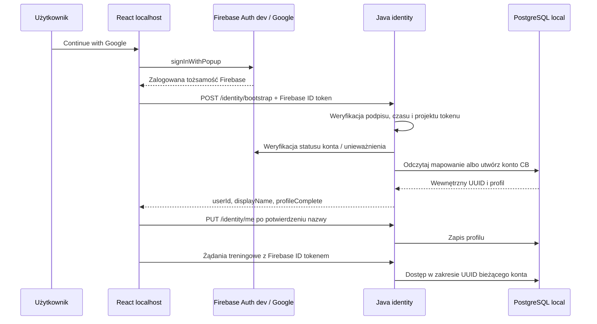

# Firebase Authentication — plan wdrożenia na lokalnym devie

Data: 2026-11-08. Status: **lokalny plan zrealizowany; prawdziwe Google Sign-In i profil Mihu odebrane przez użytkownika**. Wykonano świeżą kopię, backend/frontend auth, V24 na właściwej bazie, testy oraz osobne konta i bazę modelową. Projekt Firebase dev to `climbbetter-dev`; Google i localhost potwierdzone. UID powiązano z pierwotnym UUID002;17 aktywnych sesji/137 wpisów zachowało wszystkie dane. [Wynik i lokalne uruchomienie](firebase-authentication-local.md) dokumentują wdrożenie i końcową kontrolę. Reset i replay osobistej historii nie były potrzebne.

Plan rozwija [ustalenia frontendu](frontend-authentication.md) i lokalny zakres [środowisk](Environments_plan.md). Zakres polecenia zapisuje DEC-050, a wybór podstawowego profilu zatwierdzony przez użytkownika — DEC-051, zamykająca OPEN-26 w [rejestrze decyzji](decisions.md). Szczegóły techniczne poniżej są rekomendacją implementacji, a nie opisem działających funkcji.

Dalsze sekcje zachowują analizę i kolejność ustaloną przed implementacją. Aktualny zakres wykonany na podstawie DEC-052 i wyniki uruchomień podaje [raport lokalny](firebase-authentication-local.md).

## 1. Wniosek z przeglądu

Integracja pasuje do istniejącej architektury. Moduły `training`, `catalog` i `reporting` pobierają UUID przez `CurrentUserProvider`. Można podmienić źródło bieżącej tożsamości, zachowując UUID i istniejące relacje. **Nie znaleziono w schemacie przyczyny, dla której samo dodanie Firebase wymagałoby usunięcia treningów.** Wymaga to jeszcze testu migracji i powiązania konta.

Konto Mihu było używane jako `00000000-0000-0000-0000-000000000002`. Domyślny użytkownik procesu local to jednak `…0001`, z nazwą `Local Developer`. Przed wdrożeniem trzeba potwierdzić właściciela rzeczywistej historii, zamiast przyjąć domyślny UUID z konfiguracji.

Podczas przeglądu GET `http://127.0.0.1:8080/api/v1/identity/me` nie połączył się z serwerem. Nie uruchamiano backendu ani bazy. Najnowszy raport z 2026-11-07 opisuje 17 sesji/137 wpisów; wcześniejszy replay z 2026-11-04 obejmował 16/133. To różne punkty w czasie, nie bieżący pomiar. Nowy eksport musi objąć stan z dnia wdrożenia.

### Stan sprzed implementacji i konsekwencje

| Obszar            | Obecny stan                                            | Wymagany przyrost                                                        |
| ----------------- | ------------------------------------------------------ | ------------------------------------------------------------------------ |
| Backend identity  | `LocalCurrentUserProvider`, stały UUID dla local/test  | Tożsamość z uwierzytelnionego żądania; jawne oddzielenie trybu testowego |
| Ochrona HTTP      | W `pom.xml` brak Spring Security i Firebase Admin      | Filtr tokenu, polityka dostępu i odpowiedzi błędów                       |
| Baza użytkowników | V2: `id`, `display_name`, `created_at`                 | Mapowanie zewnętrznej tożsamości i stan uzupełnienia profilu             |
| Własność danych   | Sesje, prywatny katalog i audyt odnoszą się do UUID CB | Zachować UUID Mihu i istniejące klucze obce                              |
| Transport React   | `http.ts` wysyła JSON bez tokenu                       | Aktualny Firebase ID token, obsługa 401 i zmiany konta                   |
| Routing React     | Wszystkie ekrany dostępne, brak stanu auth             | Login, uzupełnienie profilu i ochrona tras                               |
| CORS              | Dozwolony tylko `Content-Type`                         | Dodać `Authorization` i obsługę preflight przed uwierzytelnianiem        |
| Narzędzia danych  | Archive/replay wysyłają żądania bez Bearer             | Dostosować przed użyciem z zabezpieczonym API                            |

Źródła kodu: [identity](../../backend/src/main/java/pl/climbbetter/identity/CurrentUserProvider.java), [local provider](../../backend/src/main/java/pl/climbbetter/identity/internal/LocalCurrentUserProvider.java), [endpoint me](../../backend/src/main/java/pl/climbbetter/identity/internal/CurrentUserController.java), [V2](../../backend/src/main/resources/db/migration/V2__create_users.sql), [CORS](../../backend/src/main/java/pl/climbbetter/shared/internal/web/LocalWebConfiguration.java), [HTTP](../../frontend-web/src/shared/api/http.ts), [routing](../../frontend-web/src/app/router.tsx), [szkice](../../frontend-web/src/features/training/model/session-draft.ts), [historia i narzędzia](training-history-export.md).

## 2. Granice pierwszego etapu

Lokalny React/Vite, Java i PostgreSQL w obecnym Dockerze. Prawdziwe logowanie Google przez osobny projekt **Firebase dev**, a nie emulacja konta Mihu. Dane aplikacji nadal są zapisywane przez API w PostgreSQL; nie dodajemy Firestore ani Firebase Hosting.

Użytkownik zatwierdził 2026-11-08 podstawowy profil: nazwę użytkownika, np. `Mihu`, z jednorazowym potwierdzeniem (DEC-051; OPEN-26 zamknięte). UUID nadaje backend. Ankieta wspinaczkowa pozostaje na późniejszy przyrost; nie dodajemy teraz wagi, daty urodzenia, deklarowanego poziomu ani zmian obliczeń treningowych. Zakres profilu nie blokuje już przygotowania migracji A03.

Etap obejmuje logowanie, odświeżenie strony i tokenu, wylogowanie, utworzenie nowego konta CB, powiązanie Mihu, profil podstawowy i izolację danych dwóch kont. Role ADMIN, płatności, Flutter oraz łączenie Apple/GitHub/Microsoft pozostają osobnymi etapami. Mihu nie otrzymuje uprawnień administratora z racji pierwszego logowania. OPEN-22 pozostaje otwarte.

## 3. Docelowy przepływ

Dla Mihu mapowanie zakładamy kontrolowanie **przed automatycznym tworzeniem kont CB** — procedura w sekcji 7. Żądania przyjmują Firebase ID token uzyskany przez `currentUser.getIdToken()`, a nie Google access token, Google ID token ani Firebase custom token. [Kontrakt weryfikacji Firebase](https://firebase.google.com/docs/auth/admin/verify-id-tokens).

## 4. Konfiguracja lokalnego deva

### Firebase i Google

1. Utworzyć lub wskazać osobny projekt Firebase dev i zarejestrować aplikację Web. Na ten etap wystarczy podstawowy Authentication; nie włączamy usług płatnych ani Identity Platform bez potrzeby.
2. Włączyć dostawcę Google i skonfigurować wymagane dane aplikacji/kontakt. Zweryfikować konfigurację OAuth; jeśli ekran zgody działa w trybie testowym, dodać wymagane konta testowe.
3. Przyjąć `http://localhost:5173` jako podstawowy adres ręcznego odbioru. Dodać `localhost` do Authorized domains; w nowych projektach nie jest dodawany domyślnie. Wpisujemy host, bez schematu i portu. Jeżeli używamy również `127.0.0.1`, oddzielnie sprawdzić jego dopuszczenie i logowanie; testy przeglądarkowe mogą korzystać z emulatora na dotychczasowym hoście. [FAQ Firebase](https://firebase.google.com/docs/auth/faq-and-troubleshooting).
4. Pierwszy wariant UI używa popup wywołanego bezpośrednio kliknięciem użytkownika. Obsłużyć anulowanie, blokadę popup i brak sieci. Redirect oraz jego wymagania przeglądarkowe można dodać po lokalnym odbiorze. [Google Sign-In w JavaScript](https://firebase.google.com/docs/auth/web/google-signin).

### Zmienne i poświadczenia

| Miejsce               | Proponowana konfiguracja                                                                                 | Znaczenie                                                  |
| --------------------- | -------------------------------------------------------------------------------------------------------- | ---------------------------------------------------------- |
| Frontend `.env.local` | `VITE_FIREBASE_API_KEY`, `VITE_FIREBASE_AUTH_DOMAIN`, `VITE_FIREBASE_PROJECT_ID`, `VITE_FIREBASE_APP_ID` | Konfiguracja aplikacji Web projektu dev                    |
| Frontend API          | `VITE_API_URL` puste                                                                                     | Korzystamy z istniejącego proxy Vite `/api` do 8080        |
| Backend               | `CB_AUTH_MODE=firebase`, `CB_FIREBASE_PROJECT_ID`                                                        | Jawny tryb i projekt weryfikowanych tokenów                |
| Backend               | `GOOGLE_APPLICATION_CREDENTIALS`                                                                         | Ścieżka do lokalnych poświadczeń konta usługi projektu dev |
| Testy lokalne         | `CB_AUTH_MODE=stub`                                                                                      | Stały użytkownik tylko w jawnej konfiguracji local/test    |

Publiczna konfiguracja Firebase Web, w tym API key używany przez SDK, trafia do pakietu JS i nie jest kluczem administratora. Klucz prywatny konta usługi i tokeny nigdy nie trafiają do `VITE_*`. [Zasady API keys](https://firebase.google.com/support/guides/security-checklist#api-keys-not-secret).

Firebase Admin inicjalizujemy raz z jawnym project ID i Application Default Credentials. Poświadczenia serwera przechowujemy poza repozytorium; obecne reguły ignorują `.env*`, ale nie każdy plik JSON z kluczem. Nie zapisujemy rzeczywistych wartości w planie ani plikach przykładów. Java nie wczytuje automatycznie `.env.local` Vite — zmienne backendu trzeba przekazać przez konfigurację uruchomienia IDE lub proces. Konto usługi otrzymuje uprawnienia potrzebne do używanych operacji Auth, bez roli właściciela całego projektu. [Konfiguracja Admin SDK](https://firebase.google.com/docs/admin/setup).

W trybie `firebase` brak projektu/poświadczeń kończy uruchomienie czytelnym błędem konfiguracji. Brak lub zły token nie przełącza żądania na użytkownika local. W prawdziwym dev auth odrzucamy konfigurację `FIREBASE_AUTH_EMULATOR_HOST`; emulator jest osobnym ustawieniem testów na odrębnych danych.

## 5. Backend i kontrakt API

### Weryfikacja i tożsamość

- Dodać `spring-boot-starter-security` i `com.google.firebase:firebase-admin`, dobierając aktualną zgodną wersję przy implementacji. Nie zmieniamy wersji Spring Boot przy okazji auth.
- W module `identity/internal` umieścić konfigurację Firebase, adapter `FirebaseTokenVerifier`, filtr Spring Security, principal z zaufanym issuer/UID oraz adapter `CurrentUserProvider`. Nazwy konkretnych klas można dopasować podczas implementacji.
- Filtr sprawdza Bearer przed logiką aplikacji. SDK weryfikuje podpis, ważność i zgodność z projektem dev (`aud`, `iss`); pierwsza implementacja używa `verifyIdToken(token, true)`, aby odrzucać również unieważnione tokeny i wyłączone konta. Zwykłe `verifyIdToken(token)` nie sprawdza unieważnienia. [Weryfikacja](https://firebase.google.com/docs/auth/admin/verify-id-tokens), [sesje](https://firebase.google.com/docs/auth/admin/manage-sessions), [Java API](https://firebase.google.com/docs/reference/admin/java/reference/com/google/firebase/auth/FirebaseAuth).
- Sprawdzenie unieważnienia wymaga wywołania usługi Auth. Na obecnym devie akceptujemy ten koszt; nie obiecujemy pracy offline. Awaria usługi zależnej daje kontrolowany 503, nie zalogowanie lokalne ani mylące 401. Błędne poświadczenia dają 401.
- `CurrentUserProvider` zwraca UUID odczytany z mapowania zweryfikowanego principal. Wyniku nie trzymamy w zmiennym polu singletona ani we własnym niezresetowanym `ThreadLocal`; kontekst kończy się razem z żądaniem.
- Stały `LocalCurrentUserProvider` działa tylko przy `local`/`test` oraz jawnym `auth.mode=stub`. Zwykły lokalny odbiór Firebase ma `auth.mode=firebase`. Również polityka HTTP musi mieć odrębny wariant stub, bez dostępu do niego poza local/test. Nie dopuszczamy dwóch providerów jednocześnie.

### Polityka HTTP

Całe `/api/v1/**` wymaga Firebase auth, także `/identity/bootstrap`. Tylko bootstrap może obsłużyć uwierzytelnioną tożsamość bez konta CB. Pozostałe endpointy wymagają istniejącego mapowania; dane biznesowe dodatkowo wymagają ukończenia podstawowego profilu. Nieznany UID otrzymuje `409 ACCOUNT_NOT_PROVISIONED`, a nie 500 z zapytania SQL. Niedokończony profil przy dostępie do treningów daje `403 PROFILE_INCOMPLETE`; `/identity/me` pozostaje dostępne do jego ukończenia.

Local Swagger/OpenAPI i prosty healthcheck mogą być dostępne lokalnie; pozostałe nieprzewidziane ścieżki odrzucamy. W Swaggerze dodać schemat Bearer. Prawidłowy preflight dla dozwolonego originu działa bez tokenu i przechodzi przez CORS przed auth. Dodać `Authorization` do dozwolonych nagłówków i zachować istniejące metody/ściśle wskazane originy. Z proxy Vite przeglądarka zwykle omija CORS, ale bezpośrednie API też musi działać. [Spring Security CORS](https://docs.spring.io/spring-security/reference/servlet/integrations/cors.html).

Wariant API jest stateless z tokenem wyłącznie w nagłówku, bez własnej sesji/cookie logowania. Wyłączenie CSRF dotyczy tego wariantu; ewentualne późniejsze cookies wymagają ponownego projektu ochrony CSRF. Odpowiedzi filtrów auth mają spójny JSON (`status`, `code`, `detail`) zgodny z obsługą `ApiError`; błędy filtra nie mogą polegać wyłącznie na MVC ControllerAdvice.

### Proponowane endpointy

| Endpoint                          | Zachowanie                                                                                                        |
| --------------------------------- | ----------------------------------------------------------------------------------------------------------------- |
| `POST /api/v1/identity/bootstrap` | Uwierzytelniony; idempotentnie odczytuje lub tworzy konto CB i mapowanie; 200 z profilem                          |
| `GET /api/v1/identity/me`         | Odczytuje konto CB; zachowuje `userId`, `displayName`, dodaje `profileComplete`; bez tworzenia rekordów przez GET |
| `PUT /api/v1/identity/me`         | Aktualizuje nazwę własnego profilu i potwierdza jego ukończenie; 200 z profilem                                   |

Bootstrap nie przyjmuje wskazanego przez klienta `userId`, Firebase UID, roli ani stanu ukończenia profilu. Dla nowego konta backend nadaje losowy UUID i początkową nazwę z zaufanych danych Firebase; gdy brak nazwy, ustawia nazwę techniczną do poprawy. Odczyt kolejnego logowania nie nadpisuje wybranej nazwy danymi Google. PUT przyjmuje wyłącznie `displayName`; propozycja walidacji: po trim 1–80 znaków. Nazwa nie musi być unikalnym loginem.

Konto i powiązanie powstają atomowo. Równoległy bootstrap z dwóch kart musi zwrócić ten sam UUID, bez osieroconych użytkowników; obsłużyć konflikt unikalności poprzez poprawne wycofanie transakcji i ponowny odczyt. Samo przechwycenie błędu SQL w już przerwanej transakcji nie wystarczy. Szczegóły API i limit długości nazwy pozostają propozycją techniczną; zatwierdzony zakres podstawowego profilu określa DEC-051.

## 6. Model danych i migracja

Proponowana kolejna migracja to `V24__add_external_user_identities.sql`, **o ile V24 nadal jest wolna podczas implementacji**. Zachowujemy V1–V23 i dotychczasowe migracje użytkownika.

Nowa tabela `identity.user_identities`:

- `id UUID PRIMARY KEY`;
- `user_id UUID NOT NULL REFERENCES identity.users(id)`;
- `issuer TEXT NOT NULL`, dla Firebase: `https://securetoken.google.com/<projectId>`;
- `subject TEXT NOT NULL`, czyli zweryfikowany Firebase UID;
- `created_at TIMESTAMPTZ NOT NULL`;
- `UNIQUE (issuer, subject)` — jedna tożsamość prowadzi do jednego konta CB;
- `UNIQUE (user_id, issuer)` — w tym wariancie jedno konto Firebase danego projektu na konto CB;
- kontrola niepustych `issuer` i `subject`.

W `identity.users` dodać nullable `profile_completed_at`. API wyprowadza z niego `profileComplete`; istniejące rekordy zachowują nazwę i UUID, a po powiązaniu mogą jednokrotnie potwierdzić nazwę. Na etapie podstawowym nie potrzeba osobnej tabeli ankiety. Nie zapisujemy ID tokenów ani refresh tokenów w PostgreSQL.

Rekord wiąże konto **Firebase**, nie osobne konto dla każdego Google/Apple/GitHub. Późniejsze metody można połączyć w Firebase z tym samym UID. Ten sam e-mail nie służy nam do automatycznego przejęcia istniejącego UUID. [Łączenie dostawców](https://firebase.google.com/docs/auth/web/account-linking).

Migracja jest addytywna: nie zmienia `training.training_sessions.user_id`, `catalog.areas.owner_id`, `catalog.climbs.owner_id`, `training.training_session_revisions.changed_by_user_id`, client IDs ani snapshotów. Nie wstawiamy rzeczywistego UID Mihu do wersjonowanej migracji. Lokalny seed użytkownika `…0001` może zostać jako fixture bez mapowania Google; nie daje mu to dostępu po włączeniu auth.

## 7. Powiązanie konta Mihu i ochrona danych

Wariant podstawowy:

1. Przed migracją wykonać świeży eksport historii `…0002`, zależności i sum kontrolnych. Potwierdzić liczbę aktywnych/usuniętych sesji, wpisów i revisions, właścicieli katalogu oraz rzeczywisty UUID Mihu. Zapisać oddzielny punkt odniesienia danych, które mogą się zmienić (profil) i danych, które mają pozostać identyczne (historia/katalog/audyt).
2. Sprawdzić SQL restore w izolowanej bazie. Przetestować aktualizację schematu z V23 oraz uruchomienie na pustej bazie. Eksport i testy nie nadpisują kopii z poprzedniego replay.
3. Wykonać pierwszy techniczny login Google do projektu dev. Na tym kroku frontend jeszcze nie wywołuje automatycznego bootstrapu CB. Odczytać utworzony UID w Firebase Console i potwierdzić, że to wybrane konto Mihu, w odpowiednim projekcie i z Google jako dostawcą. E-mail może pomóc operatorowi w identyfikacji, ale nie zastępuje weryfikacji tokenu.
4. Po migracji wykonać jednorazowe lokalne powiązanie `issuer + UID → …0002`, najlepiej małym narzędziem operatora w `infra/tools`. W transakcji sprawdzić obecność docelowego użytkownika i brak sprzecznych mapowań; identyczne powiązanie jest idempotentne, próba przepięcia na inne konto kończy się błędem. Nie tworzymy publicznego endpointu przyjmującego UUID do przejęcia.
5. Dopiero potem włączyć pełny bootstrap. `/identity/me` po prawdziwym logowaniu ma zwrócić UUID `…0002`, a użytkownik potwierdza nazwę `Mihu`. Błędnie utworzone drugie konto oznacza zatrzymanie procedury i sprawdzenie jego danych; nie łączymy historii automatycznie.
6. Porównać wszystkie sesje, wpisy, snapshoty, revisions i prywatny katalog z baseline. Nowe mapowanie i potwierdzenie nazwy są oczekiwanymi zmianami identity; nie wymagamy identycznego hasha całego schematu identity.

Zachowanie UUID zachowuje również klucze szkiców w przeglądarce, które już zawierają wewnętrzny `userId`. Test musi objąć odczyt istniejącego szkicu Mihu po logowaniu i jego niedostępność z konta B w UI.

### Wariant awaryjny dopuszczony przez użytkownika

Usunięcie i import są możliwością na wypadek rzeczywistego problemu, a nie warunkiem włączenia auth. Najpierw rozróżnić błędne mapowanie konta od problemu danych. Błąd tożsamości naprawiamy w identity; replay nie powinien go maskować.

Jeżeli potrzebne jest odtworzenie historii, użyć **nowego eksportu z dnia operacji** i zweryfikowanych narzędzi z [procedury historii](training-history-export.md): user-scoped soft delete aktywnych sesji z expectedVersion, a następnie chronologiczny POST wejść z dziennikiem i stałymi client IDs do ponowień. Zachować UUID Mihu, katalog i inne konta; wcześniej przetestować replay na izolowanej bazie. Stara kopia 16/133 nie obejmuje późniejszych danych. Eksport do tej operacji wykonać po ustaleniu docelowego schematu i profilu: wcześniejszy baseline sprzed auth ma inną strukturę identity i nie może bez ponownej weryfikacji służyć jako aktualny preflight usuwania.

Jeżeli najprostsze okaże się odtworzenie lokalnego środowiska od zera, preferujemy **nową bazę dev obok dotychczasowej**: pełne migracje do bieżącej wersji, konto Mihu z zachowanym UUID/mapowaniem, wymagany katalog z zachowanymi ID i import wejść. Starą bazę zachowujemy do odbioru. Nie wystarczy sam POST treningów do pustej bazy bez ich zależności katalogowych. Nie usuwamy wolumenu Docker ani danych innych kont.

SQL restore przywraca zapisane wyniki, a replay przez API ponownie je oblicza. Gdy użyjemy replay, nowe snapshoty trzeba porównać z oczekiwaniami obecnego modelu; nie przedstawiamy go jako gwarancji identycznych wyników. Nie cofamy istniejącego Flyway ani nie edytujemy starych migracji. Planowanie tej ścieżki nie uruchamia dziś żadnej operacji usuwania.

Przed użyciem po auth rozbudować archive/replay o Bearer ze zmiennej procesu lub prywatnego pliku tokenu, z zachowaniem kontroli `/identity/me`, UUID i dziennika. Nie przekazywać tokenu w URL ani argumencie widocznym na liście procesów, nie zapisywać go do receipts. Po 401 zatrzymać/wznowić z nowym tokenem tego samego konta; nie przełączać importera na stub. Eksporter/weryfikator SQL powinny objąć również nowe mapowanie identity przy odtwarzaniu zależności; obecna wersja kopiuje tylko wiersze `identity.users` i katalog.

## 8. Frontend i cykl życia konta

Zachowujemy strukturę plików z [planu frontend auth](frontend-authentication.md). Dodatkowo:

- `AuthProvider` rozróżnia ustalanie stanu SDK, brak logowania, bootstrap, wymagany profil, gotowe konto i błąd. Używa `onIdTokenChanged`, obsługuje odświeżenie i nie wysyła żądań biznesowych przed uzyskaniem konta CB. Błąd API nie jest dowodem wylogowania z Firebase.
- SDK obsługuje trwałość sesji; na dev proponujemy jawne `browserLocalPersistence`. Nie budujemy własnego magazynu tokenów w localStorage. Wylogowanie wykonuje Firebase `signOut` i usuwa dane użytkownika z pamięci UI. [Trwałość sesji Firebase](https://firebase.google.com/docs/auth/web/auth-state-persistence).
- `http.ts` pobiera aktualny `getIdToken()` przed żądaniem i dołącza nagłówek. Na 401 dopuszczamy jedno wymuszone odświeżenie i ponowienie tej samej operacji tylko dla tej samej tożsamości. Brak pętli retry. Utrata odpowiedzi zapisu nadal korzysta z obecnego `pendingRequest`, idempotencji i expectedVersion.
- Zmiana konta podczas pobierania tokenu, żądania lub odświeżenia anuluje/ignoruje poprzedni wynik. Nie wolno ponowić operacji użytkownika A z tokenem B. Zmiana auth generacji unieważnia kontekst żądań i montuje chronioną część aplikacji od nowa; samo zachowanie `useResource(path)` nie wystarczy, bo jego klucz nie zawiera konta.
- Dodać `/login` i `/profile/setup`; pozostałe trasy chroni `RequireAuth`. Login wraca tylko na dozwoloną wewnętrzną trasę. W trakcie ustalania stanu nie pokazujemy poprzednich danych ani chwilowego formularza loginu. Niedokończony profil prowadzi do setup bez pętli przekierowań.
- `AppLayout` i strony pobierające dziś osobno `/identity/me` korzystają ze wspólnego profilu w auth context. Typ `CurrentUser` przenosimy z `training/model` do `profile/model`, aby kontrakt konta nie należał do modułu treningowego.
- Edytor nadal używa UUID CB jako klucza szkicu. Wylogowanie nie wysyła ani nie usuwa automatycznie szkiców. Konto B nie dostaje szkicu A; niepotwierdzona operacja może być wznowiona po powrocie A. LocalStorage na wspólnym profilu przeglądarki nie jest izolowanym sejfem, więc rozdzielenie kont w UI nie oznacza ochrony przed osobą mającą dostęp do narzędzi przeglądarki.
- Menu pokazuje nazwę profilu i wylogowanie. Błędy popup, 401, brak sieci i 503 mają komunikat i możliwość ponowienia; token nie trafia do komunikatu, logu ani zrzutu testu.

## 9. Kolejność realizacji i warunki ukończenia

Każdy etap kończymy dowodem działania przed przejściem dalej. Nie wymaga to wykonania wszystkich punktów jednocześnie w rozmowie.

| Etap | Zakres                                                           | Warunek ukończenia                                                         |
| ---- | ---------------------------------------------------------------- | -------------------------------------------------------------------------- |
| A00  | Baseline, świeży eksport i izolowany SQL restore                 | Znany UUID Mihu, aktualne liczby/hash i działająca kopia                   |
| A01  | Projekt Firebase dev, Web, Google, domena i konfiguracja         | Ustalony projekt i poświadczenia, bez sekretów w repo                      |
| A02  | SDK w React i techniczny login, bez bootstrapu                   | Prawdziwy login/logout Google; znany UID Mihu                              |
| A03  | Migracja identity i powiązanie Mihu                              | Test pustej/istniejącej bazy, historia identyczna, UID prowadzi do `…0002` |
| A04  | Spring Security, token verifier, principal i CurrentUserProvider | 401 bez/z błędnym tokenem, poprawny UUID po weryfikacji, CORS działa       |
| A05  | Bootstrap i podstawowy profil                                    | Idempotentne konto CB, walidacja nazwy, brak duplikacji po retry           |
| A06  | AuthProvider, transport, routing, menu i szkice                  | Login, reload, wygaśnięcie i zmiana konta bez mieszania danych             |
| A07  | Testy regresji i auth na odrębnych danych                        | Sprawdzone HTTP i UI, błędne tokeny, dwa konta, historia zachowana         |
| A08  | Ręczny odbiór Mihu i aktualizacja instrukcji local               | Prawdziwe Google, nazwa Mihu, historia/raporty oraz zapis testowy działają |

Ścieżka odtworzenia z sekcji 7 jest warunkowa. Nie dodajemy jej do normalnego wdrożenia, jeśli migracja i mapowanie zachowają dane.

## 10. Weryfikacja do wykonania przy implementacji

**Backend:** testy nowej granicy HTTP z prawdziwym łańcuchem Spring Security, podmiennym adapterem weryfikacji i PostgreSQL Testcontainers. Sprawdzić brak tokenu, uszkodzony/wygaśnięty token, obcy issuer/projekt, konto wyłączone/unieważnione, niedostępność Firebase, nieznany UID, niedokończony profil, konflikt mapowania i równoległy bootstrap. Tokeny błędnego projektu i podpisu sprawdzić także na rzeczywistym adapterze weryfikacji; mock nie dowodzi poprawnej konfiguracji Admin SDK.

**Izolacja A/B:** dwa uwierzytelnione principale mapują się na różne UUID. B nie widzi ani nie edytuje/usuwa sesji A; obcy zasób zachowuje 404. Sprawdzić prywatne Area/Climb, kalendarz, Dashboard i oba raporty Statistics, a nie tylko ekran główny. Sekwencyjne i równoległe żądania nie przenoszą principal między użytkownikami. Publiczny katalog pozostaje wspólny.

**Frontend:** build, lint, istniejące testy modelu i Playwright oraz scenariusze logowania, odświeżenia strony, wylogowania, podstawowego profilu, błędu popup, błędu backendu, pojedynczego retry 401, zmiany konta podczas żądania i szkicu z pendingRequest. Testy przeglądarkowe nie logują automatycznie prawdziwych kont Google: używają odrębnego Auth Emulatora i izolowanej bazy lub kontrolowanego adaptera w fixture. Odbiór prawdziwego Google jest osobnym testem ręcznym; emulator go nie zastępuje. Emulator wydaje niepodpisane tokeny i nie może być włączony dla konta Mihu w prawdziwym trybie firebase. [Ograniczenia emulatora](https://firebase.google.com/docs/emulator-suite/connect_auth).

Istniejące testy biznesowe mogą zachować jawny stub, ale nie uznajemy ich za test auth. Dostosować konfigurację `@WebMvcTest` i MockMvc do nowego łańcucha; nie wyłączać globalnie filtrów, aby odzyskać zielony wynik. Testy izolacji auth muszą obejmować całą granicę HTTP i rzeczywiste mapowanie w DB.

**Dane Mihu:** przed/po migracji i powiązaniu porównać pełne rekordy historii, snapshoty, rewizje i katalog. Po odbiorze logowania sprawdzić odczyt starej sesji i raportów; CRUD wykonać na osobnej sesji testowej ze świadomością, że jej soft delete pozostawia audyt. Nie porównywać wtedy liczby rekordów z baseline tak, jakby nie było zapisów testowych. Przy replay oddzielnie sprawdzić wejścia, nowe obliczenia i brak duplikacji.

**Granica dowodów tego dokumentu:** przejrzano repozytorium i aktualną dokumentację Firebase/Spring, a próba odczytu API 8080 nie powiodła się. Nie wykonywano migracji, eksportu, testów aplikacji ani logowania Google. Wyniki wcześniejszych 210 testów backendu i testów web pozostają dowodami wcześniejszych przyrostów.

## 11. Następny mały krok

Przy realizacji zacząć od A00: uruchomiony lokalny backend/baza, potwierdzenie UUID i świeży eksport ze sprawdzeniem odtworzenia. Następnie A01: osobny projekt Firebase dev. Konkretny projekt, UID i poświadczenia ustalamy podczas konfiguracji; nie są potrzebne do zatwierdzenia samego planu.
