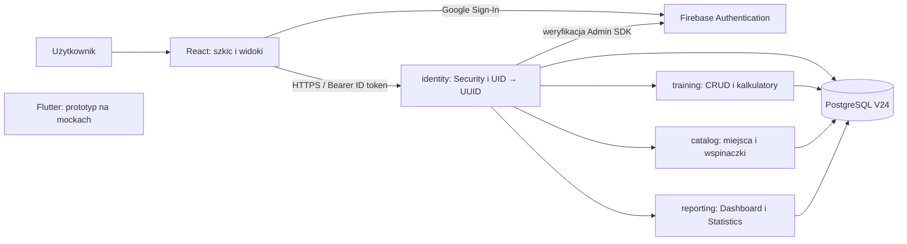

# Komponenty

Aktualizacja: 2026-11-09. Stan z kodu; produkcja i mobile offline pozostają planami.

Local ma osobny Auth Emulator/bazę modeli. Obecny Compose uruchamia tylko PostgreSQL. [Opis modułów](../architecture.md), [plan hostingu i CI/CD](../Environments_plan.md).
