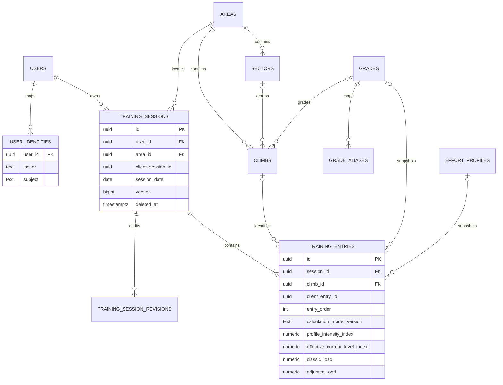

# ERD — schemat wdrożony

Aktualizacja: 2026-11-09. Uproszczenie relacji z migracji V1–V24, bez pełnej listy kolumn. [Opis bazy](../database.md).

Snapshot jest zapisany w kolumnach wpisu, summary w sesji. Rozgrzewka nie ma Grade/Climb/profilu. Revisions dotyczą sesji, a nie osobnej tabeli snapshotów wpisu. Widoki `reporting.achievement_ascents` i `session_achievement_maxima` nie są kopiami danych. Trwały UserGradeReference pozostaje planem, dlatego nie występuje w ERD.
