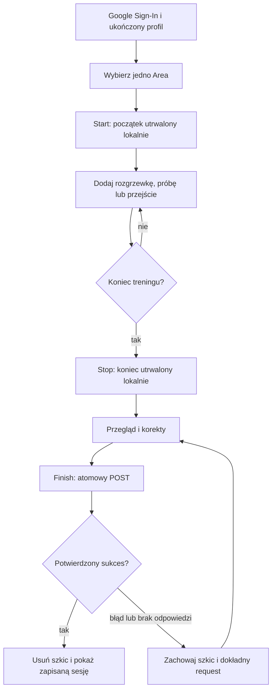

# Record session

Aktualizacja: 2026-11-09. Wdrożony przepływ web, źródło: formularz sesji i lokalny szkic.

Bez pauzy i serwerowego Start. Ręczna sesja pomija pomiar Start/Stop, podając czasy. [Zasady i powtarzanie](../../business/training.md).
