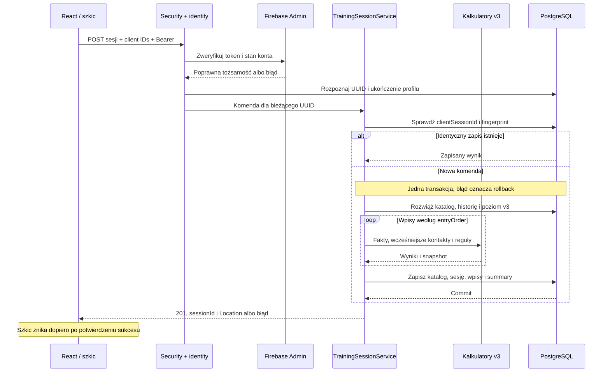

# Sekwencja zapisu sesji

Aktualizacja: 2026-11-09. Wdrożony POST; pełna ochrona kolejności różnych równoległych sesji pozostaje w OPEN-12.

Niepoprawna tożsamość/profil przerywają przepływ przed operacją biznesową. Inna treść pod istniejącym client ID daje konflikt. PUT dodatkowo sprawdza wersję i zapisuje rewizję przed/po; GET nie liczy ponownie. [Kontrakt](../api.md).
